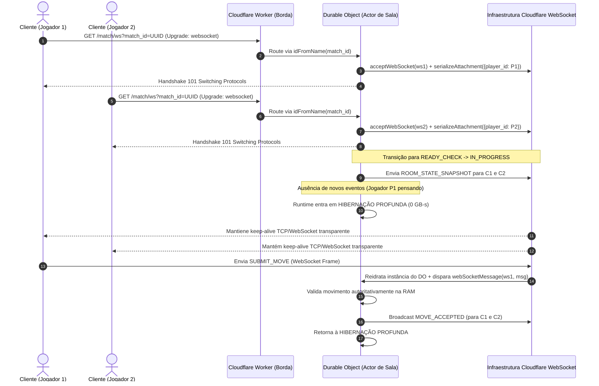
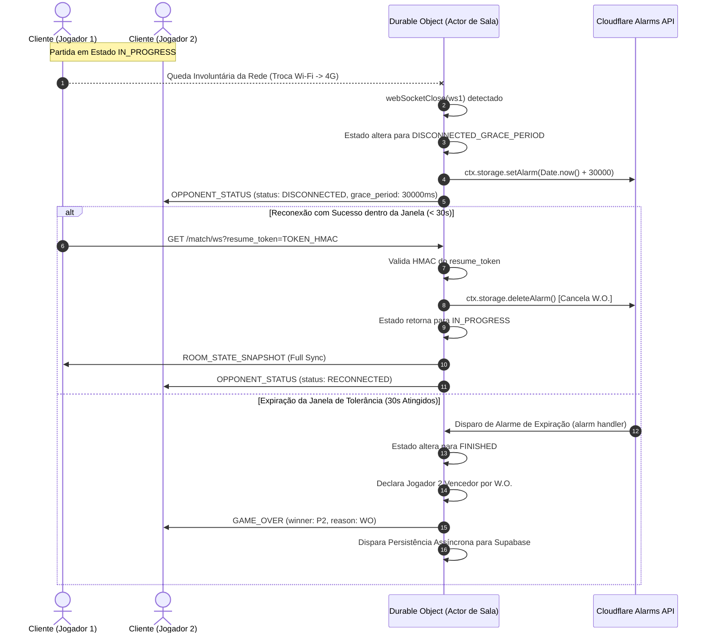
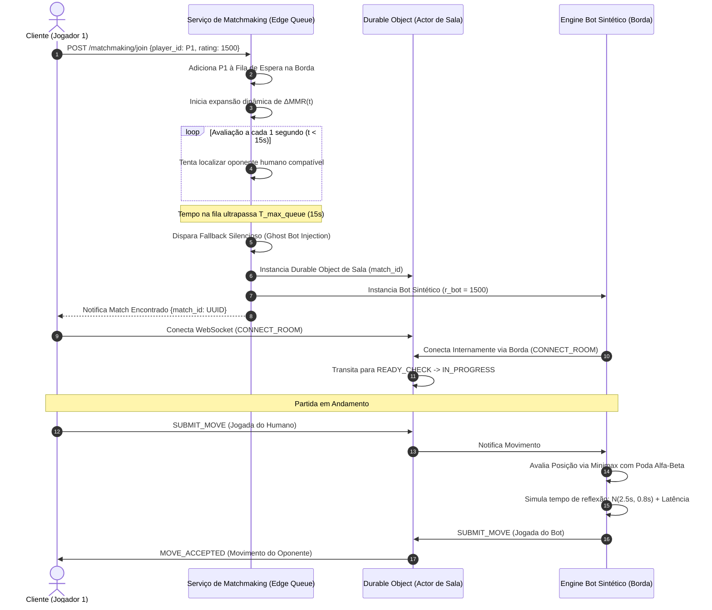

# Especificação Arquitetural: Infraestrutura Multiplayer Autoritativa Serverless, Sincronização e Matchmaking para Jogos de Tabuleiro Competitivos

## 1. Visão Geral e Papel Arquitetural

A implementação de jogos multiplayer síncronos e competitivos em arquiteturas serverless tradicionais enfrentava historicamente a incompatibilidade entre o modelo *stateless* (funções FaaS efêmeras) e a necessidade de estado persistente em tempo real. A introdução da computação na borda baseada em atores (*Stateful Edge Actors*), exemplificada pelos Cloudflare Durable Objects e pelo ecossistema PartyKit, permite instanciar serviços com estado em memória colocalizados geograficamente com os usuários.

Esta especificação técnica define a arquitetura de um servidor autoritativo para jogos de tabuleiro competitivos 1v1 em turnos, estruturada sob a premissa de **custo inicial zero em repouso (*Zero-Cost Cold Start*)**. O sistema isola todo o processamento de regras, temporização e sincronização dentro de atores na borda, mantendo a camada de banco de dados relacional (Supabase PostgreSQL) totalmente desonerada de leituras e escritas durante a execução das partidas.

---

## 2. Arquitetura de Sala Autoritativa (Stateful Edge & Durable Objects)

### 2.1 Ciclo de Vida e Isolamento por Atores

Cada partida iniciada no sistema corresponde a uma instância única e isolada de um **Cloudflare Durable Object**. O identificador global da sala (`room_id` ou `match_id`) é um UUID v4 gerado no momento do matchmaking, garantindo roteamento determinístico na borda através do método `idFromName`.

1. **Ponto de Entrada (Cloudflare Worker)**: O Worker atua como um roteador HTTP/WebSocket leve de borda. Ao receber uma solicitação de conexão client-side, ele extrai o `match_id`, obtém o stub do Durable Object correspondente e encaminha o *handshake* de upgrade do WebSocket.
2. **Autoridade Única (*Single Source of Truth*)**: O Durable Object correspondente é instanciado na borda mais próxima dos jogadores. Ele mantém o estado autoritativo do tabuleiro na memória RAM (com apoio opcional do SQLite local do próprio actor para persistência rápida em disco de borda).
3. **Hibernação de WebSocket (*WebSocket Hibernation API*)**: Para zerar os custos computacionais (GB-segundos) durante o tempo em que os jogadores estão deliberando suas jogadas, o Durable Object utiliza a API de Hibernação. Quando nenhum evento está sendo processado, o runtime JavaScript do actor é suspenso e removido da memória pelo Cloudflare. A conexão TCP/WebSocket permanece mantida pela infraestrutura global de rede, que responde a Pings/Pongs do protocolo sem acordar o código da aplicação.
4. **Anexos e Reidratação (*Attachment Serialization*)**: Para preservar o contexto da sessão sem consultar bancos externos ao reativar a instância, o servidor utiliza `serializeAttachment` e `deserializeAttachment`. Metadados essenciais (ex: `player_id`, `session_token`, turno atual, relógio) são anexados diretamente ao socket no momento da aceitação (`acceptWebSocket`). Ao chegar um novo payload do cliente, o Cloudflare acorda a instância e entrega a mensagem juntamente com seus metadados recuperados.

### 2.2 Diagrama de Sequência: Conexão, Hibernação e Reidratação na Borda



---

## 3. Especificação do Protocolo de Rede e Contratos de Mensagens

A comunicação opera sobre protocolo WebSocket utilizando payloads estruturados em formato JSON (ou Protocol Buffers para redução de *overhead*). Todas as mensagens contêm obrigatoriamente um campo de ordenamento sequencial incremental (`seq`) por canal para permitir identificação de pacotes perdidos ou fora de ordem.

### 3.1 Eventos Enviados pelo Cliente (Client -> Server)

| Nome do Evento | Campos do Payload (Schema) | Critérios de Validação no Servidor | Reação / Ação do Motor |
| :--- | :--- | :--- | :--- |
| `CONNECT_ROOM` | `match_id` (string)<br>`player_id` (string)<br>`resume_token` (string)<br>`client_time` (int64) | 1. Validação da assinatura HMAC do `resume_token`.<br>2. Verificação se `player_id` pertence aos participantes autorizados da partida. | Registra o socket; cancela alarmes de W.O. pendentes; transmite o `ROOM_STATE_SNAPSHOT` completo. |
| `READY_CHECK` | `player_id` (string)<br>`client_timestamp` (int64) | 1. Estado da sala deve ser `READY_CHECK`.<br>2. `player_id` deve ser válido. | Marca prontidão do jogador. Ao obter confirmação de ambos, altera estado da sala para `IN_PROGRESS` e inicia o Relógio Fischer. |
| `SUBMIT_MOVE` | `move_id` (string)<br>`from_coord` (string/object)<br>`to_coord` (string/object)<br>`client_time_remaining` (int64)<br>`seq` (int64) | 1. Estado da sala deve ser `IN_PROGRESS`.<br>2. `player_id` anexado ao socket deve corresponder ao turno atual.<br>3. `seq` deve ser o sucessor direto do último `seq` processado.<br>4. Movimento deve ser legal segundo o motor de regras.<br>5. Validação de *drift* de tempo ($T_{\text{drift\_threshold}} = 200\text{ ms}$). | Atualiza o tabuleiro na RAM; aplica compensação de latência ao Relógio Fischer; altera o turno; transmite `MOVE_ACCEPTED`. |
| `PING_SYNC` | `client_time` (int64) | 1. Socket autenticado e ativo na sala. | Responde imediatamente com `PONG_SYNC` contendo carimbos de tempo do servidor para cálculo de RTT. |
| `SURRENDER` | `player_id` (string)<br>`reason` (string) | 1. Estado da sala deve ser `IN_PROGRESS` ou `DISCONNECTED_GRACE_PERIOD`.<br>2. Requisitante deve ser participante da sala. | Altera estado da sala para `FINISHED`; declara o oponente vencedor; aciona rotina de persistência assíncrona. |

### 3.2 Eventos Enviados pelo Servidor (Server -> Client)

| Nome do Evento | Campos do Payload (Schema) | Comportamento Esperado no Cliente |
| :--- | :--- | :--- |
| `ROOM_STATE_SNAPSHOT` | `match_id` (string)<br>`board_state` (object)<br>`turn_player_id` (string)<br>`p1_clock_ms` (int64)<br>`p2_clock_ms` (int64)<br>`seq` (int64)<br>`game_state` (enum) | Redesenha a interface do jogo; reinicia renderização visual; reconfigura os relógios locais conforme valores autoritativos. |
| `MOVE_ACCEPTED` | `move_id` (string)<br>`applied_move` (object)<br>`next_turn_player_id` (string)<br>`p1_clock_ms` (int64)<br>`p2_clock_ms` (int64)<br>`seq` (int64) | Executa a animação de movimento confirmada pelo servidor; altera a posse do turno e sincroniza os temporizadores. |
| `MOVE_REJECTED` | `move_id` (string)<br>`error_code` (string)<br>`corrected_board_state` (object) | Reverte a previsão local (*optimistic UI rollback*); exibe alerta de movimento inválido; restaura peças na posição autoritativa. |
| `CLOCK_UPDATE` | `p1_clock_ms` (int64)<br>`p2_clock_ms` (int64)<br>`active_player_id` (string) | Ajusta os contadores de relógio locais do dispositivo para eliminar desvios (*clock drift*). |
| `GAME_OVER` | `winner_id` (string)<br>`termination_reason` (enum: `CHECKMATE`, `TIMEOUT`, `RESIGNATION`, `WO`) <br>`final_rating_changes` (object) | Congela interações no tabuleiro; exibe tela de vitória/derrota com a atualização de pontuação Glicko-2. |
| `OPPONENT_STATUS` | `opponent_id` (string)<br>`status` (enum: `DISCONNECTED`, `RECONNECTED`)<br>`grace_period_remaining_ms` (int64) | Exibe indicador visual de perda de conexão do adversário e inicia contagem regressiva da janela de tolerância. |

---

## 4. Máquina de Estados da Sala e Resiliência Mobile

### 4.1 Transições da Máquina de Estados Finitos (FSM)

O ciclo de vida da partida é rigidamente controlado por uma FSM mantida no Durable Object. Requisições que violem a fase atual são descartadas.

```
                    ┌──────────────────┐
                    │ WAITING_PLAYERS  │
                    └────────┬─────────┘
                             │ 2 Jogadores Conectados
                             ▼
                    ┌──────────────────┐
                    │   READY_CHECK    │
                    └──┬────────────┬──┘
    Timeout (10s)   │            │ Ambos READY
   / Cancelamento   │            ▼
                    │   ┌──────────────────┐
                    │   │   IN_PROGRESS    │◄─────────────────┐
                    │   └──┬────────────┬──┘                  │
                    │      │            │ Queda de Socket     │ Reconexão
                    │      │            ▼                     │ Token Válido
                    │      │   ┌──────────────────────────┐   │ (< 30s)
                    │      │   │DISCONNECTED_GRACE_PERIOD ├───┘
                    │      │   └────────────┬─────────────┘
                    │      │                │
                    │      │                │ Alarm DO Expira (30s W.O.)
                    ▼      ▼                ▼
                  ┌───────────────────────────┐
                  │         FINISHED          │
                  └───────────────────────────┘
```

| Estado Origem | Evento de Gatilho | Estado Destino | Condições de Guarda e Ações do Servidor |
| :--- | :--- | :--- | :--- |
| `WAITING_PLAYERS` | Associação dos 2 participantes à sala | `READY_CHECK` | Associa sockets via `acceptWebSocket`; armazena tokens de sessão; programa temporizador de prontidão de 10 segundos. |
| `READY_CHECK` | Confirmação `READY_CHECK` de ambos os clientes | `IN_PROGRESS` | Sorteia o jogador inicial; inicializa os relógios Fischer autoritativos; salva o timestamp oficial de início. |
| `READY_CHECK` | Expiração do tempo limite de 10s | `FINISHED` | Cancela a partida sem alteração de MMR; reencaminha os clientes para a fila de matchmaking. |
| `IN_PROGRESS` | Evento `webSocketClose` de um participante | `DISCONNECTED_GRACE_PERIOD` | Pausa a contagem do turno; registra o timestamp de desconexão; aciona a Alarms API (`ctx.storage.setAlarm(Date.now() + 30000)`). |
| `DISCONNECTED_GRACE_PERIOD` | Recebimento de `CONNECT_ROOM` com `resume_token` válido | `IN_PROGRESS` | Cancela o alarme de W.O. pendente; retransmite `ROOM_STATE_SNAPSHOT`; retoma a contagem do Relógio Fischer. |
| `DISCONNECTED_GRACE_PERIOD` | Disparo do Alarme do Durable Object (30 segundos expirados) | `FINISHED` | Confirma derrota por W.O. do jogador ausente; encerra a partida; notifica o jogador presente; aciona gravação assíncrona. |
| `IN_PROGRESS` | Condição de fim de jogo (Xeque-mate/Timeout) ou `SURRENDER` | `FINISHED` | Congela estado da sala; calcula deltas do algoritmo Glicko-2; dispara escrita no Supabase; encerra conexões. |

### 4.2 Protocolo de Resiliência Mobile (*Session Resumption*)

Para tratar a alta volatilidade de redes móveis (troca de Wi-Fi para 4G/5G, travessias de túneis e quedas momentâneas de sinal), o protocolo adota reconexão transparente:

1. **Geração do Token de Sessão**: Na transição para `IN_PROGRESS`, o servidor gera para cada participante um token criptográfico assinado (`resume_token`):
   $$	ext{resume\_token} = 	ext{Base64URL}(	ext{match\_id} \mathbin{\Vert} 	ext{player\_id} \mathbin{\Vert} 	ext{expires\_at} \mathbin{\Vert} 	ext{HMAC-SHA256}(	ext{secret}, 	ext{data}))$$
2. **Tratamento de Queda no Servidor**: Quando a conexão física cai, a infraestrutura da Cloudflare dispara o manipulador `webSocketClose`. O Durable Object programa um alarme na borda para exatamente 30 segundos no futuro via `ctx.storage.setAlarm()`. Se o objeto hibernar, a Cloudflare garante a reidratação exata no trigésimo segundo para consolidar a vitória por W.O.
3. **Reconexão Transparente**: O cliente móvel, ao detectar o retorno da rede, reabre o WebSocket enviando o `resume_token`. O servidor valida a assinatura HMAC, invalida o alarme de W.O., reassocia o socket aos metadados e responde com o `ROOM_STATE_SNAPSHOT`. O cliente aplica o estado autoritativo sem perda de progresso.

### 4.3 Diagrama de Sequência: Desconexão e Reconexão Transparente (Session Resumption)



---

## 5. Sincronização de Relógio Fischer e Compensação de Latência

### 5.1 Formulação Matemática do Relógio Fischer

O controle de tempo baseia-se no sistema de **Relógio Fischer**, onde cada jogador possui uma reserva inicial de tempo $T_{	ext{base}}$ e ganha um incremento fixo $T_{	ext{inc}}$ a cada jogada validada.

Seja $T_{i, k}$ o tempo restante em milissegundos para o jogador $i$ no início do seu turno $k$. A atualização do tempo disponível para o turno $k+1$ é definida por:

$$T_{i, k+1} = T_{i, k} - \Delta t_{	ext{consumido}} + T_{	ext{inc}}$$

Onde $\Delta t_{	ext{consumido}}$ é o tempo decorrido no turno, mensurado pela autoridade do servidor e ajustado pelo cálculo de compensação de latência.

### 5.2 Estimativa de Latência de Uma Via (One-Way Delay)

Para evitar que a latência de rede prejudique os jogadores, o servidor calcula a estimativa de tempo de uma via ($L_{	ext{oneway}}$) a partir das trocas contínuas de pacotes `PING_SYNC` / `PONG_SYNC`:

$$	ext{RTT} = t_{	ext{client\_recv\_pong}} - t_{	ext{client\_send\_ping}}$$

$$L_{	ext{oneway}} = rac{	ext{RTT}}{2}$$

Ao submeter a jogada via `SUBMIT_MOVE`, o cliente anexa o carimbo do momento do clique no dispositivo ($t_{	ext{client\_send}}$). O servidor registra o instante de recepção do pacote ($t_{	ext{server\_recv}}$) e calcula a duração bruta do turno no servidor:

$$\Delta t_{	ext{servidor}} = t_{	ext{server\_recv}} - t_{	ext{turn\_start\_servidor}}$$

A dedução corrigida atribuída ao relógio do jogador é calculada aplicando o amortecimento da latência de uma via:

$$\Delta t_{	ext{corrigido}} = \max\left(0, \Delta t_{	ext{servidor}} - L_{	ext{oneway}}
ight)$$

### 5.3 Política de Validação Anti-Cheat Temporal (*Lag Hacking Prevention*)

Para proibir que clientes maliciosos enviem valores falsificados de $t_{	ext{client\_send}}$ no intuito de zerar o consumo do relógio, o servidor impõe um limite máximo de tolerância a divergências ($T_{	ext{drift\_threshold}} = 200	ext{ ms}$):

$$	ext{Divergência} = \left| (\Delta t_{	ext{servidor}} - L_{	ext{oneway}}) - \Delta t_{	ext{cliente}} 
ight|$$

$$	ext{Se } 	ext{Divergência} > T_{	ext{drift\_threshold}} \implies 	ext{Ignora } \Delta t_{	ext{cliente}} 	ext{ e aplica } \Delta t_{	ext{servidor}}$$

Caso a divergência supere o limite de $200	ext{ ms}$, o cálculo autoritativo desconsidera o parâmetro enviado pelo cliente, aplicando a penalização baseada no tempo do servidor e sinalizando a anomalia temporal.

---

## 6. Algoritmo de Matchmaking, Glicko-2 e Fallback Silencioso de Bot

### 6.1 Formulação Matemática Completa do Algoritmo Glicko-2

O algoritmo Glicko-2 quantifica a habilidade dos jogadores através de três parâmetros: a classificação $r$ (*Rating*), o desvio de classificação $RD$ (*Rating Deviation*, incerteza) e a volatilidade $\sigma$ (consistência de desempenho).

#### Passo 1: Conversão para a Escala Glicko-2
Os valores iniciais $r$ e $RD$ são convertidos para a escala interna do algoritmo:

$$\mu = rac{r - 1500}{173.7178}$$

$$\phi = rac{RD}{173.7178}$$

A volatilidade $\sigma$ permanece idêntica na conversão.

#### Passo 2: Função de Incerteza e Expectativa de Vitória
Para um confronto contra um oponente com parâmetros ($\mu_j, \phi_j$), o fator de redução por incerteza $g(\phi_j)$ e a expectativa teórica de vitória $E(\mu, \mu_j, \phi_j)$ são dados por:

$$g(\phi_j) = rac{1}{\sqrt{1 + rac{3\phi_j^2}{\pi^2}}}$$

$$E(\mu, \mu_j, \phi_j) = rac{1}{1 + \exp\left(-g(\phi_j)(\mu - \mu_j)
ight)}$$

#### Passo 3: Variância $v$ e Melhoria de Desempenho $\Delta$
A variância estimada $v$ da pontuação e a variação observada $\Delta$ são calculadas como:

$$v = \left[ g(\phi_j)^2 \cdot E(\mu, \mu_j, \phi_j) \cdot \left(1 - E(\mu, \mu_j, \phi_j)
ight) 
ight]^{-1}$$

$$\Delta = v \cdot g(\phi_j) \cdot \left(s_j - E(\mu, \mu_j, \phi_j)
ight)$$

Onde $s_j \in \{1.0, 0.5, 0.0\}$ representa vitória, empate ou derrota, respectivamente.

#### Passo 4: Atualização da Volatilidade $\sigma'$ pelo Método Illinois
Define-se a função $f(x)$ contendo a constante de restrição do sistema $	au$ (fixada em $	au = 0.5$):

$$f(x) = rac{e^x (\Delta^2 - \phi^2 - v - e^x)}{2(\phi^2 + v + e^x)^2} - rac{x - \ln(\sigma^2)}{	au^2}$$

O valor de $x = \ln(\sigma'^2)$ é determinado numericamente pela técnica da falsa posição (Algoritmo Illinois) até alcançar a convergência em $|B - A| \le 10^{-6}$. A nova volatilidade é calculada como $\sigma' = e^{x/2}$.

#### Passo 5: Recálculo do Desvio e Retorno para a Escala Original
O desvio pré-partida atualizado $\phi^*$ e o novo desvio final $\phi'$ são:

$$\phi^* = \sqrt{\phi^2 + \sigma'^2}$$

$$\phi' = rac{1}{\sqrt{rac{1}{(\phi^*)^2} + rac{1}{v}}}$$

A nova classificação em escala interna $\mu'$ é:

$$\mu' = \mu + (\phi')^2 \cdot g(\phi_j) \cdot \left(s_j - E(\mu, \mu_j, \phi_j)
ight)$$

Por fim, os valores são convertidos para a escala Glicko tradicional:

$$r' = 173.7178 \cdot \mu' + 1500$$

$$RD' = 173.7178 \cdot \phi'$$

### 6.2 Expansão Exponencial da Janela de Busca no Matchmaking

Para equilibrar o tempo de espera e a paridade de habilidade, o intervalo máximo aceitável de classificação ($\Delta 	ext{MMR}$) expande-se dinamicamente conforme o tempo de espera na fila ($t_{	ext{espera}}$ em segundos):

$$\Delta 	ext{MMR}(t_{	ext{espera}}) = \Delta 	ext{MMR}_{	ext{inicial}} + eta \cdot (t_{	ext{espera}})^{\gamma}$$

Com parâmetros de calibração fixados em $\Delta 	ext{MMR}_{	ext{inicial}} = 50$, $eta = 15$ e $\gamma = 1.2$. O sistema aprova o pareamento entre o Jogador A e o Jogador B se:

$$|r_A - r_B| \le \min\left(\Delta 	ext{MMR}(t_A), \Delta 	ext{MMR}(t_B)
ight)$$

### 6.3 Arquitetura de Fallback Silencioso para Bot (*Ghost Bot Matchmaking*)

Para solucionar o "Problema da Sala Vazia" durante o lançamento do aplicativo, caso o tempo na fila ultrapasse $T_{	ext{max\_queue}} = 15	ext{ segundos}$, a camada de matchmaking aciona o Fallback Silencioso de Bot:

1. **Injeção Transparente**: O matchmaking cria um Durable Object de sala idêntico ao de um confronto real e injeta uma entidade sintética no slot do oponente.
2. **Calibragem e Heurística**: O bot é inicializado com rating idêntico ao do jogador humano ($r_{	ext{bot}} = r_{	ext{humano}}$). Ele utiliza uma árvore de busca Minimax com Poda Alfa-Beta, ajustando a profundidade de avaliação conforme a faixa de rating do usuário.
3. **Simulação do Tempo de Reflexão Humano**: O bot não executa jogadas instantâneas. O tempo decorrido antes de enviar cada movimento é amostrado de uma distribuição gaussiana combinada com a latência de rede simulada:

$$t_{	ext{pensamento}} = \mathcal{N}(\mu_{	ext{pensamento}}, \sigma_{	ext{pensamento}}^2) + t_{	ext{latência\_sintética}}$$

A média $\mu_{	ext{pensamento}}$ varia dinamicamente entre 1.5s e 4.0s de acordo com a complexidade tática do tabuleiro, imitando o ritmo de pensamento humano.

### 6.4 Diagrama de Sequência: Matchmaking e Fallback de Bot Fantasma



---

## 7. Prevenção de Abusos, Anomalias e Anti-Cheat Passivo

### 7.1 Combate ao Win-Trading e Sandbagging

Como todo o motor de regras e temporização é mantido no servidor autoritativo, modificações no cliente não alteram o tabuleiro. Contudo, fraudes comportamentais são bloqueadas passivamente:

*   **Detecção de Pareamentos Repetitivos**: O sistema consulta o histórico recente. Se a taxa de confrontos entre dois usuários específicos $A$ e $B$ ultrapassar $5\%$ de suas partidas totais em um período de 24 horas, o matchmaking impede novos pareamentos ranqueados entre essa dupla.
*   **Impressão Digital de Rede e Dispositivo**: O servidor analisa a subrede IP (`/24` para IPv4) e a impressão digital criptográfica do dispositivo. Requisições originadas na mesma subrede IP ou no mesmo dispositivo são proibidas de ser pareadas no modo competitivo.
*   **Mitigação de Sandbagging (Derrotas Intencionais)**: Jogadores que surrenderam ou abandonam partidas consecutivas com menos de 3 turnos concluídos têm as alterações de MMR zeradas e suas contas recebem uma flag de auditoria.

### 7.2 Detecção Passiva de Engines Externos e Bots de Terceiros

Para identificar jogadores que utilizem motores de IA rodando em paralelo no dispositivo, a arquitetura aplica duas métricas estatísticas assíncronas:

1. **Entropia de Shannon da Distribuição do Tempo de Ponderação**: Seres humanos demandam tempos variáveis para decidir jogadas (decisões triviais são rápidas; posições complexas exigem reflexão). Bots tendem a apresentar tempos uniformes. O servidor calcula a entropia $H(T)$:

$$H(T) = - \sum_{i} P(t_i) \log_2 P(t_i)$$

Entropias anormalmente baixas associadas a movimentos de alta precisão disparam alertas de auditoria.

2. **Perda Média de Centipawn (*Centipawn Loss - CPL*)**: Em partidas de alto nível, o sistema submete a notação completa da partida (PGN) para uma avaliação assíncrona pós-jogo contra um motor analítico. Se a taxa de concordância do jogador com as primeiras opções da engine for superior a $98\%$ ao longo de múltiplas partidas, a conta é suspensa preventivamente do modo competitivo.

---

## 8. Arquitetura de Dados e Persistência Diferida

### 8.1 Separação entre Camadas de Armazenamento

Para assegurar o custo operacional zero em repouso, o modelo separa rigidamente o estado volátil da borda da camada relacional persistente.

| Camada de Armazenamento | Tecnologia Utilizada | Entidades e Dados Armazenados | Ciclo de Vida do Dado | Impacto Financeiro e E/S |
| :--- | :--- | :--- | :--- | :--- |
| **Camada Volátil (Edge Stateful)** | Cloudflare Durable Objects (RAM e SQLite Local) | Estado do tabuleiro, lista de sockets ativos, relógios autoritativos, `resume_token`, fila de mensagens `seq`. | Ativo durante a partida; purgado após o estado `FINISHED`. | **Zero consumo de banco relacional.** Operações cobertas pelo nível gratuito da Cloudflare. |
| **Camada Persistente (Relacional)** | Supabase (PostgreSQL) | Perfis de usuários, histórico global de partidas, tabelas de classificação (Leaderboards), registros de sanções. | Armazenamento permanente de longo prazo. | **E/S reduzida a 1 única escrita atômica por partida concluída.** |

### 8.2 Fluxo de Encerramento e Transação Atômica no PostgreSQL

Ao atingir o estado `FINISHED`, o Durable Object executa o procedimento de persistência assíncrona sem bloquear a experiência final dos clientes:

1. **Consolidação do Resumo**: O ator compila o PGN da partida, motivo do término (`CHECKMATE`, `RESIGNATION`, `TIMEOUT`, `WO`), tempo total decorrido e os deltas de rating Glicko-2 processados na borda.
2. **Despacho Assíncrono Idempotente**: O Durable Object efetua uma requisição HTTP POST assíncrona para o endpoint do Supabase, incluindo um cabeçalho de idempotência:
   `Idempotency-Key: match_id`
   Em caso de falha de rede, o Durable Object aplica política de retry com *exponential backoff* até obter confirmação `HTTP 200/201`.
3. **Transação Atômica no Supabase**: A Stored Procedure do PostgreSQL executa o bloco transacional isolado (`BEGIN ... COMMIT`):
   - Insere o registro completo na tabela `match_history`.
   - Atualiza os parâmetros $r$, $RD$ e $\sigma$ de ambos os jogadores na tabela `user_profiles`.
   - Registra métricas e flags de auditoria na tabela `audit_logs`.

### 8.3 Diagrama de Sequência: Persistência Assíncrona no PostgreSQL

```mermaid
sequenceDiagram
    autonumber
    actor C1 as Cliente (Jogador 1)
    actor C2 as Cliente (Jogador 2)
    participant DO as Durable Object (Actor de Sala)
    participant SupaAPI as Supabase API (HTTP Endpoint)
    database PG as Supabase PostgreSQL

    Note over DO: Partida atinge Estado FINISHED
    DO->>DO: Processa cálculo final do Glicko-2 (r', RD', σ')
    DO->>DO: Compila PGN e resumo da partida
    DO->>C1: GAME_OVER (winner_id, final_ratings)
    DO->>C2: GAME_OVER (winner_id, final_ratings)

    DO->>SupaAPI: POST /rest/v1/rpc/finalize_match<br>Header: Idempotency-Key: match_id<br>Payload: {match_id, PGN, winner_id, p1_stats, p2_stats}
    
    activate SupaAPI
    SupaAPI->>PG: Executa Stored Procedure: finalize_match()
    activate PG
    Note over PG: BEGIN TRANSACTION
    PG->>PG: INSERT INTO match_history (...)
    PG->>PG: UPDATE user_profiles SET r=r', RD=RD', σ=σ' WHERE id=P1
    PG->>PG: UPDATE user_profiles SET r=r', RD=RD', σ=σ' WHERE id=P2
    PG->>PG: INSERT INTO audit_logs (...)
    Note over PG: COMMIT TRANSACTION
    PG-->>SupaAPI: Success 200 OK
    deactivate PG
    SupaAPI-->>DO: HTTP 200 OK (Match Persisted)
    deactivate SupaAPI

    DO->>DO: Purga estado da memória RAM e encerra actor
```

---

## 9. Resumo das Decisões Arquiteturais

| Componente | Solução Adotada | Benefício Técnico Principal | Custo de Infraestrutura |
| :--- | :--- | :--- | :--- |
| **Runtime Multiplayer** | Cloudflare Durable Objects / PartyKit | Servidor de sala autoritativo em memória na borda com latência ultrabaixa. | **R$ 0,00** (Plano gratuito Cloudflare: 1M requisições/dia). |
| **Gestão de Conexões** | WebSocket Hibernation API | Preserva o socket TCP ativo sem gastar tempo de CPU durante deliberações. | **R$ 0,00** (Hibernação não consome GB-segundos). |
| **Resiliência Mobile** | Session Resumption + Cloudflare Alarms | Tolerância transparente a quedas de rede (30s) com alarme garantido na borda. | **R$ 0,00** (Alarms inclusos na infraestrutura de borda). |
| **Sincronização de Tempo** | Relógio Fischer + Drift Threshold (200ms) | Compensação de latência justa sem permitir exploração maliciosa de tempo. | **R$ 0,00** (Cálculo puramente computacional na RAM). |
| **Matchmaking & Rating** | Glicko-2 + Ghost Bot Fallback (15s) | Pareamento justo com retenção imediata de usuários em momentos de baixo tráfego. | **R$ 0,00** (Executado na fila da borda / Minimax local). |
| **Persistência de Dados** | Supabase (PostgreSQL) com Gravação Deferred | Banco de dados limpo, acessado estritamente 1 vez ao final da partida. | **R$ 0,00** (Plano gratuito Supabase: 500MB DB, 50 mil requisições/mês). |
