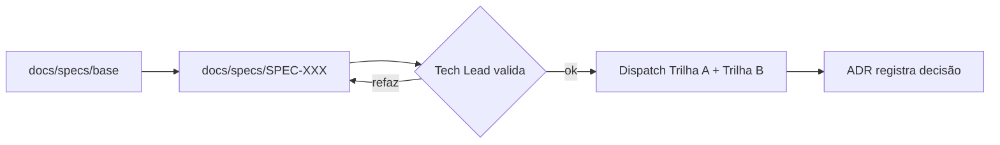

# Specs base (referência de produto)

Documentos de origem que alimentam as SPECs ativas (`docs/specs/SPEC-XXX-*.md`)
e os ADRs (`docs/adr/`). São **material de referência**, não contrato de
implementação: tudo que será construído deve ser extraído para uma SPEC-XXX
com contrato TypeScript e critério de aceite antes do início do dev.

Também alimentam as SPECs os documentos de alto nível do projeto:
[`docs/prd/PRD.md`](../../prd/PRD.md) (requisitos de produto) e
[`docs/tdd/TDD.md`](../../tdd/TDD.md) (desenho técnico).

| Arquivo | Escopo | Status |
| :--- | :--- | :--- |
| [01-regras-uttt-matematica.md](01-regras-uttt-matematica.md) | Regras formais do UTTT, notação, topologia | ✔ Consumida pela SPEC-001 |
| [02-especificacao-tecnica-ia.md](02-especificacao-tecnica-ia.md) | Especificação técnica da IA | ✔ Consumida pela SPEC-002 |
| [03-multiplayer-serverless-matchmaking.md](03-multiplayer-serverless-matchmaking.md) | PartyKit, salas, matchmaking serverless | ✔ Consumida pela SPEC-004 (sala/protocolo; matchmaking fica p/ próxima) |
| [04-economia-f2p.md](04-economia-f2p.md) | Economia free-to-play, moedas, cosmetics | ⏳ Não fatiado |
| [05-ux-mobile-gamefeel-ai-harness.md](05-ux-mobile-gamefeel-ai-harness.md) | UX mobile, game feel, harness de IA | ✔ Consumida pela SPEC-003 (UI/sessão; harness CI parcial) |
| [06-pagamentos-zero-data.md](06-pagamentos-zero-data.md) | Pagamentos sem dados sensíveis | ⏳ Não fatiado |
| [07-conformidade-privacy-appsec.md](07-conformidade-privacy-appsec.md) | Privacidade, LGPD/Kids, AppSec | ⏳ Não fatiado |
| [08-game-design-arquitetura.md](08-game-design-arquitetura.md) | Visão de game design e arquitetura geral | ⏳ Referência transversal |

## Fluxo

1. Extrair requisito da spec base → escrever `SPEC-XXX` com Tasks A/B paralelas.
2. Validação técnica (Tech Lead) antes do dispatch aos devs.
3. Decisões estruturais viram ADR em `docs/adr/`.
